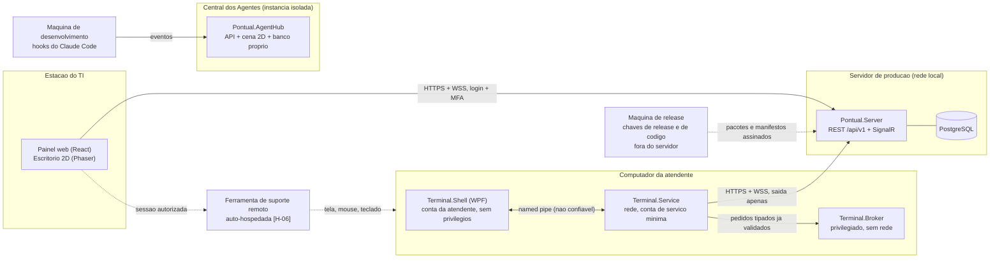
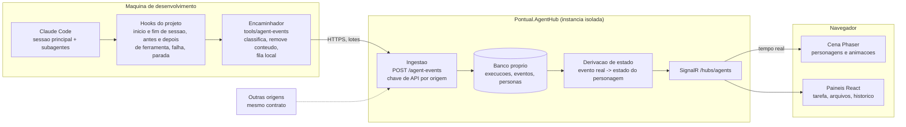

# Terminal Pontual — Arquitetura

Status: **revisão 2**. Incorpora a revisão do agente `ecc:architect` e as decisões aprovadas pela Pontual. Nenhum código foi escrito; a implementação aguarda aprovação.

Convenções deste documento:

- **[H-xx]** marca uma hipótese ainda não comprovada. A lista completa está na seção 10 e cada uma é verificada na Fase 0 (ver [ROADMAP.md](ROADMAP.md)).
- Nenhuma funcionalidade do Windows é tratada como confirmada. Tudo o que depende de edição, versão ou comportamento do sistema é hipótese até haver teste na máquina real e referência à documentação oficial da Microsoft, registrados em ADR.

## 1. Visão geral

São duas instalações independentes:

1. **Produção**: servidor central, painel do TI e os terminais das atendentes.
2. **Central dos Agentes**: instância separada, usada no desenvolvimento, sem acesso às máquinas nem às credenciais de produção.



## 2. Componentes

| Sigla | Componente | Tecnologia | Onde roda | Responsabilidade |
|---|---|---|---|---|
| SRV | `Pontual.Server` | ASP.NET Core (.NET 10 LTS), EF Core, SignalR | Servidor | API, autenticação, autorização, distribuição de configuração, alertas, auditoria |
| ADM | `Pontual.Admin` | React, TypeScript, Vite, Phaser | Navegador do TI | Painel e escritório virtual |
| SVC | `Pontual.Terminal.Service` | .NET Worker Service | Cada PC | Única parte que fala com a rede: identidade da máquina, configuração, telemetria, presença |
| BRK | `Pontual.Terminal.Broker` | .NET, serviço Windows | Cada PC | Única parte privilegiada, **sem rede**: aplica e reverte políticas, instala atualizações, controla o agente de suporte |
| SHL | `Pontual.Terminal.Shell` | WPF + WebView2 | Sessão da atendente | Interface, abertura dos aplicativos, consentimento de suporte |
| INS | `Pontual.Terminal.Installer` | WiX (MSI) | Executado pelo TI | Instalação, registro da máquina, reversão |
| HUB | `Pontual.AgentHub` | ASP.NET Core + React + Phaser | Instância isolada | Central dos Agentes de IA |
| — | `Pontual.Contracts` | Biblioteca .NET | Compartilhada | Contratos entre servidor e terminal |

### Separação de privilégios no terminal

A revisão mostrou que um único serviço teria de rodar como sistema e, ao mesmo tempo, falar com a rede e com a atendente. O desenho passa a ter três processos:

| Processo | Conta | Fala com a rede | Recebe entrada da atendente | Pode alterar o sistema |
|---|---|---|---|---|
| Shell | atendente (usuário padrão) | não | sim | não |
| Service | conta de serviço mínima **[H-05]** | sim | sim, pelo pipe, tratada como não confiável | não |
| Broker | sistema **[H-05]** | não | não | sim, só o conjunto fechado de operações |

Regras:

- O Broker só aceita pedidos do Service, de um conjunto fechado, e **revalida** assinatura e conteúdo antes de agir. Ele não confia que o Service já validou.
- **Quem abre os aplicativos é o Shell**, com a conta da atendente. Service e Broker nunca iniciam aplicativos de usuário. A barreira real é a lista de permissão de execução do Windows, não o Shell.
- **Um único responsável reinicia o Shell.** Se o mecanismo de shell do Windows reiniciar o processo sozinho, o Broker não o faz; caso contrário, o Broker o faz. A escolha sai do PoC **[H-04]**.
- O canal Shell ↔ Service é um *named pipe* tratado como entrada hostil: o Service o cria como primeira instância, e o Shell verifica que o processo do outro lado é o Service instalado **[H-17]**.

## 3. Tecnologias escolhidas

A pilha aprovada foi preservada. A revisão não justificou nenhuma troca.

| Decisão | Escolha | Justificativa |
|---|---|---|
| Plataforma | .NET 10 LTS | Suporte longo, mesma linguagem em servidor e terminal, acesso às APIs do Windows |
| Shell | WPF | Maduro e estável fora do Explorer, sem exigir MSIX |
| Sites liberados | WebView2 no Shell, com configuração endurecida (seção 6) | Navegação controlada sem barra de endereço |
| Backend | ASP.NET Core | SignalR e Identity nativos |
| Tempo real | SignalR sobre WSS | Reconexão e grupos prontos, clientes .NET e JS |
| Banco | PostgreSQL, **sem particionamento** | O volume previsto não justifica; ver seção 8 |
| Painel | React + TypeScript + Vite | Ecossistema e tipagem |
| Cenas 2D | Phaser | Mapa, animação, câmera e entrada prontos; o PixiJS é só o renderizador |
| Instalador | WiX | MSI com reversão |
| Suporte remoto | Ferramenta existente auto-hospedada **[H-06]** | Evita protocolo próprio de tela e entrada |

**Construir ou adotar.** Não foi avaliado se parte do bloqueio deve ser entregue por uma ferramenta de gerenciamento existente (MDM ou RMM) em vez de código próprio. Essa avaliação é obrigatória na Fase 0 e vira ADR. Ela pode reduzir o escopo do Broker, mas não muda Shell, painel nem cenas 2D.

## 4. Comunicação

### Terminal ↔ Servidor

- Sempre iniciada pelo terminal. Nenhuma porta de entrada é aberta nos PCs.
- O terminal valida o servidor contra a CA da Pontual **fixada no cliente do Service**. A CA não é instalada como raiz confiável da máquina, para não valer para outros sites.
- O protocolo tem um conjunto fechado de mensagens (ver [API.md](API.md)). Não há mensagem de execução de comando.
- Sem servidor, o terminal segue com a última configuração válida. A telemetria fica em fila local com limite; ao encher, descarta primeiro eventos de uso e preserva os de segurança.

### O que o servidor consegue fazer nas máquinas

A versão anterior afirmava que um servidor comprometido não daria controle das máquinas. **Isso não é verdade como estava escrito.** O que o desenho garante, e o que não garante:

| Ação do servidor | Limite aplicado no terminal |
|---|---|
| Publicar configuração | Assinatura válida, sequência maior que a atual, máquina e perfil corretos |
| Liberar um executável | Recusado se estiver na lista de bloqueio fixa do terminal ou fora dos diretórios protegidos (seção 6) |
| Colocar em manutenção | Mensagem assinada, com prazo; expira localmente; **não** remove restrições da conta da atendente |
| Pedir suporte remoto | Consentimento ou aviso prévio na tela, aviso permanente local, expiração local |
| Distribuir atualização | Só instala pacote assinado pela chave de release, que **não fica no servidor** |

Limitação assumida: a chave que assina a configuração fica no servidor. Quem comprometer o servidor consegue publicar configuração válida e, portanto, liberar para a atendente qualquer programa já presente na máquina que não esteja na lista fixa. O programa roda como usuário padrão. Reduzir esse risco exige manter a chave do catálogo de executáveis fora do servidor; a decisão fica para o modelo de ameaças da Fase 0. Os riscos residuais estão em [SECURITY.md](SECURITY.md).

### Presença

*Heartbeat* a cada 30 s; offline após 90 s sem sinal. Só as transições são gravadas.

### Relógio

Tokens, expirações e a ordem da auditoria dependem do relógio. É necessário um servidor de horário acessível na rede local (pendência de infraestrutura).

## 5. Chaves e confiança

| Chave | Onde fica | O que assina ou protege | Troca |
|---|---|---|---|
| Identidade da máquina | No PC; em TPM quando houver **[H-11]** | Autenticação do terminal | Rota de rotação; várias chaves por máquina |
| Configuração | Servidor (online) | Configuração, manutenção, pedido de suporte | O terminal aceita um conjunto de chaves; a nova chega por atualização assinada |
| Release | Fora do servidor | Manifesto de atualização | Idem |
| Assinatura de código | Fora das máquinas de desenvolvimento, em hardware **[H-15]** | Binários e instalador | Editor fixado no terminal |
| CA TLS | Guardada pelo TI | Certificado do servidor | Renovação documentada |

Sem TPM, a chave da máquina é protegida apenas por software, e um administrador local consegue extraí-la.

## 6. Bloqueio do Windows

O bloqueio usa mecanismos oficiais do Windows, em camadas, e **vale só para a conta da atendente**. A conta do TI não pode ser afetada.

| Camada | Mecanismo candidato | Situação |
|---|---|---|
| Conta | Usuário local padrão | Base do desenho |
| Shell | Shell Launcher, política de interface personalizada ou Acesso Atribuído | Disponibilidade por edição não confirmada **[H-01]** |
| Execução | AppLocker ou Controle de Aplicativos (WDAC) | Aplicação por usuário e por edição não confirmada **[H-02]** |
| Sistema | Políticas aplicadas por usuário ou no registro da conta da atendente | Não confirmado que a conta do TI fica intacta **[H-03]** |
| Teclado | Filtro de teclado | Disponibilidade por edição não confirmada **[H-01]** |
| Rede | DNS ou proxy para os sites | Infraestrutura a definir **[H-09]** |

Pontos que o PoC precisa responder antes de qualquer código de bloqueio:

- Se o mecanismo de execução escolhido for aplicado ao dispositivo inteiro, ele restringe também o TI. Nesse caso é preciso outra combinação.
- O que acontece quando o shell termina, e quem o reinicia **[H-04]**.
- Quais combinações de teclas continuam disponíveis e o que elas expõem.

### Executáveis permitidos

1. **Lista de bloqueio fixa**, embutida no binário assinado do terminal: interpretadores e ferramentas do sistema que servem para executar comandos (por exemplo `cmd`, `powershell`, `wscript`, `cscript`, `mshta`, `rundll32`, `regedit`). Nenhuma configuração remota a remove; ela só muda por atualização assinada.
2. O executável precisa estar em diretório que a atendente não consegue gravar.
3. Incluir ou alterar um executável exige **dois administradores** (ver [SECURITY.md](SECURITY.md)).

### WebView2

Configuração obrigatória, verificada por teste: ferramentas de desenvolvedor desligadas, menu de contexto desligado, atalhos do navegador desligados, novas janelas bloqueadas ou redirecionadas, esquemas diferentes de `https` recusados, downloads bloqueados, gerenciador de senhas e preenchimento automático desligados.

A lista de sites no WebView2 é conveniência. Um link dentro de um site liberado só é contido pelo controle na rede **[H-09]**.

### Modo manutenção

Manutenção **não desbloqueia a conta da atendente**. Ela tira a máquina de serviço: o terminal mostra uma tela de manutenção, e o TI trabalha na própria conta administrativa. Tem justificativa, prazo e aviso na tela, e expira localmente mesmo sem servidor.

### Recuperação

A reversão completa do bloqueio é executada localmente pelo TI, pela conta administrativa, e existe desde a primeira versão que aplica bloqueio (Fase 2). Ela é testada antes de cada versão.

## 7. Suporte remoto

A ferramenta é escolhida por PoC na Fase 0 **[H-06]**. Condições que ela precisa cumprir, ou não é adotada:

- o agente da ferramenta fica **parado fora de sessão** e só é iniciado pelo Broker depois do consentimento;
- não existe caminho de conexão que não passe por uma sessão registrada; o console próprio da ferramenta fica sem contas utilizáveis;
- o aviso na tela vem de um processo independente do Shell, sempre no topo;
- a expiração é aplicada no terminal, mesmo com o servidor fora do ar;
- os registros da ferramenta são importados para a auditoria.

## 8. Dados e escala

- Para 10 máquinas, um servidor modesto basta.
- **Sem particionamento.** Com 500 máquinas, a estimativa é de poucos milhões de linhas de uso em 90 dias, volume que índices e exclusão em lote atendem. O particionamento complicaria migrações e chaves. A decisão fica em ADR e pode ser revista com dados reais.
- SignalR em um nó; *backplane* só com mais de um nó.
- Distribuição de atualização por canal (piloto e estável), atribuído por máquina.

## 9. Estrutura de diretórios

```
Terminal-Pontual/
├── docs/                         documentação e ADRs (docs/adr/)
├── src/
│   ├── server/
│   │   ├── Pontual.Server/
│   │   ├── Pontual.Domain/
│   │   ├── Pontual.Infrastructure/
│   │   └── Pontual.Contracts/
│   ├── terminal/
│   │   ├── Pontual.Terminal.Service/     rede, sem privilégio
│   │   ├── Pontual.Terminal.Broker/      privilegiado, sem rede
│   │   ├── Pontual.Terminal.Shell/       interface WPF
│   │   ├── Pontual.Terminal.Ipc/         contratos dos canais locais
│   │   └── Pontual.Terminal.Lockdown/    aplicação e reversão de políticas
│   ├── admin/                        painel React
│   │   └── src/{features,game,shared}/
│   ├── agenthub/                     Central dos Agentes (instância isolada)
│   │   ├── Pontual.AgentHub/
│   │   └── web/
│   ├── game-shared/                  base Phaser comum às duas cenas
│   └── installer/
├── assets/{art-src,brand}/
├── tools/
│   ├── agent-events/                 encaminhador de hooks do Claude Code
│   └── release/                      assinatura de pacotes, fora do servidor
├── tests/
│   ├── server/  terminal/  admin/  agenthub/
│   └── lockdown/                     roteiro de fuga e de reversão
└── deploy/
```

## 10. Hipóteses a comprovar

Cada item vira um resultado registrado em ADR. Enquanto não for comprovado, nenhum documento o trata como fato.

| ID | Hipótese | Como comprovar |
|---|---|---|
| H-01 | Existe, na edição real das máquinas, um mecanismo oficial para substituir o shell e limitar o teclado | Documentação oficial + teste na máquina |
| H-02 | Existe lista de permissão de execução aplicável só à atendente nessa edição | Documentação oficial + teste |
| H-03 | As políticas podem ser aplicadas por usuário, deixando a conta do TI intacta | Teste comparando as duas contas |
| H-04 | Comportamento do Windows quando o shell termina, e quem deve reiniciá-lo | Teste |
| H-05 | O Service funciona com conta mínima, e o Broker consegue agir na sessão da atendente | Teste de privilégios |
| H-06 | Alguma ferramenta de suporte cumpre todas as condições da seção 7 | PoC da ferramenta |
| H-07 | O ambiente resiste ao roteiro de fuga (diálogos, acessibilidade, macros, WebView2) | Roteiro de fuga |
| H-08 | A reversão devolve a máquina ao estado anterior | Teste de reversão e recuperação |
| H-09 | Há DNS ou proxy capaz de limitar os sites | Avaliação de infraestrutura |
| H-10 | Há gestão de senha da conta local do TI por máquina (por exemplo, LAPS) nessa edição | Documentação oficial + teste |
| H-11 | As máquinas têm TPM utilizável para a chave de identidade | Inventário |
| H-12 | É possível coletar os logons locais da conta do TI | Teste |
| H-13 | Os *hooks* do Claude Code informam qual agente executou cada ferramenta | Documentação oficial consultada em 16/11/2026: indica que sim (seção 13). **Falta o teste real** com subagentes |
| H-14 | O WebView2 e o Windows recebem correções de segurança sem acesso livre à internet | Avaliação de infraestrutura |
| H-15 | Requisitos atuais para certificado de assinatura de código | Consulta à autoridade certificadora |
| H-16 | Nenhum aplicativo real das atendentes exige privilégio de administrador | Levantamento dos aplicativos |
| H-17 | O Shell consegue verificar a identidade do processo do outro lado do pipe | Teste |

## 11. Dependências externas

- .NET 10 SDK, Node.js, PostgreSQL, WebView2 Runtime.
- Certificado TLS (CA interna) e certificado de assinatura de código.
- DNS ou proxy, e servidor de horário, na rede local.
- Ferramenta de suporte remoto auto-hospedada.
- Aseprite ou LibreSprite, e Tiled.
- Identidade visual da Pontual e arte em pixel art original.

## 12. Riscos técnicos

| Risco | Impacto | Tratamento |
|---|---|---|
| Nenhuma combinação de bloqueio atende na edição real | Alto | H-01 a H-03 na Fase 0; sem isso o projeto não avança |
| Bloqueio atinge a conta do TI | Alto | H-03; reversão local desde a Fase 2 |
| Servidor ou conta de administrador comprometidos | Alto | Limites locais da seção 4; risco residual documentado |
| Ferramenta de suporte abre acesso fora do fluxo | Alto | H-06 na Fase 0, antes de desenhar Service e Broker |
| Fuga por diálogos, acessibilidade ou WebView2 | Alto | H-07; roteiro repetido a cada versão |
| Auditoria adulterada por quem administra o servidor | Médio | Âncora externa; detecção, não impedimento |
| Sem infraestrutura de DNS ou proxy | Médio | H-09; sem ela, o controle de sites é parcial |
| TLS, certificados e relógio na rede local | Médio | CA fixada no cliente; servidor de horário |
| Produção de arte atrasa as cenas | Médio | Arte provisória própria primeiro |
| *Hooks* não identificam o agente | Baixo | H-13; sem o dado, o evento é atribuído à sessão |

## 13. Central dos Agentes

A Central dos Agentes é um **módulo independente do produto** e parte importante dele. Ela **não é** a interface das atendentes: a atendente usa o Shell, no computador controlado; a Central é uma tela de acompanhamento do desenvolvimento, usada pela equipe técnica. As duas só compartilham a identidade visual e a base de cena 2D.

### O que ela é

Um escritório virtual em pixel art 2D, feito em **Phaser**, em que cada personagem representa um agente real do Claude Code: a sessão principal e os subagentes que ela lança. O conceito visual está em [UI-CONCEPT.md](UI-CONCEPT.md), seção 3, e os requisitos em [REQUIREMENTS.md](REQUIREMENTS.md), Módulo 5.

### Arquitetura de eventos



Etapas:

1. **Captura.** Os *hooks* do Claude Code, configurados no projeto, disparam em eventos reais: início e fim de sessão, envio de instrução, antes e depois de cada ferramenta, falha de ferramenta e parada.
2. **Encaminhamento.** Um encaminhador local transforma cada disparo em um evento do contrato. Ele classifica a atividade, **remove conteúdo** (envia nome da ferramenta, caminho de arquivo e resumo curto, nunca o conteúdo de arquivos, comandos ou conversas) e guarda em fila local se a Central estiver fora do ar. Ele não pode atrasar nem interromper o Claude Code: roda sem bloquear e falha em silêncio.
3. **Ingestão.** A Central valida a chave da origem, grava o evento e atualiza a execução correspondente.
4. **Derivação de estado.** O estado do personagem (trabalhando, programando, analisando, testando, aguardando, concluído, com erro) é calculado só a partir de eventos recebidos. Sem evento recente, o personagem sai de cena ou fica ocioso.
5. **Tempo real.** A mudança é enviada por SignalR à cena Phaser e aos painéis.

O contrato de eventos e as regras de classificação estão em [API.md](API.md), seção 5. O modelo de dados está em [DATABASE.md](DATABASE.md), seção 7.

### Identificação do agente

Para um personagem representar o agente certo, o evento precisa dizer **qual agente executou a ferramenta**: a sessão principal ou um subagente específico. Isso é a hipótese **H-13**, verificada em duas etapas: consulta à documentação oficial dos *hooks* e teste real com subagentes na Fase 0.

**Resultado da consulta à documentação** (code.claude.com/docs/en/hooks e /sub-agents, em 16/11/2026, lida por extrato; os trechos-chave ainda devem ser conferidos no navegador):

| Ponto | O que a documentação diz |
|---|---|
| Identificação | Os campos comuns `agent_id` e `agent_type` acompanham os eventos de ferramenta disparados dentro de um subagente |
| Ciclo de vida | Existem `SubagentStart` e `SubagentStop`, com `agent_id` e `agent_type`; o segundo traz o caminho do transcript do subagente |
| Agentes de plugin | O tipo vem com o prefixo do plugin (padrão `plugin:agente`) |
| Falhas | Existe `PostToolUseFailure` |
| Tarefas | Existem `TaskCreated` e `TaskCompleted`, com identificador e assunto da tarefa; não há evento de progresso geral |
| Transporte | Existe *hook* do tipo `http`, mas só o tipo `command` aceita execução assíncrona |

Consequências para o desenho:

- A chave do personagem é o `agent_id`; o rótulo é o `agent_type`. `SubagentStart` abre a execução e `SubagentStop` a encerra.
- O encaminhador é um *hook* `command` **assíncrono**, que entrega o evento a um processo local. Um *hook* `http` direto atrasaria cada ferramenta.
- "Tarefa atual" e progresso vêm de `TaskCreated` e `TaskCompleted`. O progresso exibido é a contagem de tarefas concluídas sobre criadas, quando esses eventos existirem.

Ainda **não comprovado**, e por isso parte do teste da Fase 0: se `agent_id` vem ausente na sessão principal; se `session_id` é o mesmo nos eventos de subagente; o valor exato de `agent_type` para agentes do ECC; os campos de `PostToolUseFailure`.

Regra, qualquer que seja o resultado do teste: se o evento não identificar o agente, a atividade aparece na mesa da sessão. **Nenhum agente é presumido.**

### O que aparece e o que não aparece

| Informação | Quando é exibida |
|---|---|
| Estado do personagem | Sempre, derivado do último evento real |
| Tarefa atual | Quando a origem a informa |
| Arquivos relacionados | Quando a ferramenta opera sobre arquivos |
| Progresso | Só quando a origem envia dado real de progresso; caso contrário, "sem dados" |
| Histórico e atividade recente | Eventos recebidos, em ordem |

### Isolamento

- Instância, banco, contas e chaves **próprios**. Nenhuma rota de máquinas, nenhuma credencial de produção.
- Roda onde o desenvolvimento acontece. Não precisa estar na rede das atendentes, e o servidor de produção não a conhece.
- Uma falha ou comprometimento da Central não alcança os terminais (ameaça T-19 de [SECURITY.md](SECURITY.md)).

### Reaproveitamento

A base de cena (`src/game-shared/`: carregamento de mapa, personagens, animação, câmera, entrada) é comum à Central e ao escritório virtual das máquinas. Só a base é compartilhada; os dados e as instâncias não.

### Skills de apoio

Na data desta revisão, **não há skill de Phaser nem de pixel art instalada**, nem no ECC nem nas demais. Existe `pixijs-2d`, que é de outro motor e não se aplica. Skills instaladas que ajudam indiretamente: `frontend-design`, `ecc:react-patterns`, `ecc:frontend-patterns`, `ecc:e2e-testing` e o Playwright para verificação visual.

O planejamento inclui, antes da Fase 7: procurar skills de Phaser e de pixel art instaláveis e, se não houver uma adequada, criar skills próprias do projeto com as convenções da cena (grade, paleta, folhas de sprites, estados de animação).
