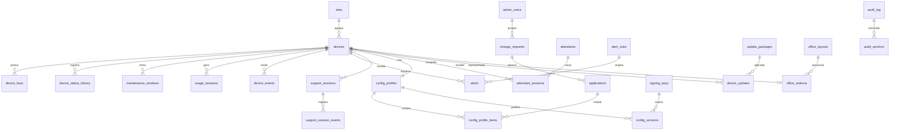

# Terminal Pontual — Banco de dados

Status: **revisão 2**. Incorpora a revisão do agente `ecc:architect` e as decisões aprovadas pela Pontual. PostgreSQL, acesso por EF Core.

São **dois bancos separados**: o de produção (seções 2 a 6) e o da Central dos Agentes (seção 7). Não há ligação entre eles.

## 1. Convenções

- Nomes em `snake_case`, tabelas no plural.
- Chave primária `id uuid` (UUID v7), gerada pela aplicação.
- Datas em `timestamptz`, UTC.
- Enumerações como `text` com `CHECK`.
- Dados variáveis em `jsonb`.
- **Sem particionamento.** O volume previsto não justifica, e tabelas particionadas exigiriam a coluna de partição em toda chave primária e estrangeira. A retenção é feita por exclusão em lote. A decisão fica em ADR e pode ser revista com dados reais.
- Migrações versionadas, só para frente em produção; mudanças destrutivas em duas etapas.
- O usuário de banco da aplicação não tem `UPDATE` nem `DELETE` em `audit_log` e `audit_anchors`.

## 2. Visão geral (produção)

## 3. Tabelas de produção

### Administração e acesso

**`admin_users`** — administradores. As tabelas do ASP.NET Core Identity (senha, segundo fator, códigos de recuperação, bloqueio) são geradas pelo framework e ligadas a esta.

| Coluna | Tipo | Observação |
|---|---|---|
| id | uuid PK | |
| email | text único | |
| display_name | text | |
| role | text | `superadmin`, `admin`, `support`, `auditor` |
| is_active | boolean | |
| is_break_glass | boolean | conta de acesso de emergência; todo uso gera alerta |
| mfa_enrolled_at | timestamptz nulo | sem isso, a única ação permitida é cadastrar o segundo fator |
| created_at, last_login_at | timestamptz | |

**`change_requests`** — aprovação por dois administradores.

| Coluna | Tipo | Observação |
|---|---|---|
| id | uuid PK | |
| kind | text | `executable.add`, `executable.change`, `support.formal` |
| payload | jsonb | o que está sendo pedido |
| justification | text | obrigatório |
| requested_by | uuid FK admin_users | |
| requested_at | timestamptz | |
| status | text | `pending`, `approved`, `rejected`, `expired` |
| decided_by | uuid FK admin_users nulo | `CHECK (decided_by <> requested_by)` |
| decided_at | timestamptz nulo | |
| expires_at | timestamptz | proposta sem decisão expira |

**`audit_log`** — somente inserção.

| Coluna | Tipo | Observação |
|---|---|---|
| id | uuid PK | |
| sequence | bigint único | atribuído por um único escritor, para a cadeia não se ramificar |
| occurred_at | timestamptz | |
| actor_type | text | `admin`, `attendant`, `device`, `system` |
| actor_id | uuid nulo | conforme o tipo; sem FK, por ser de vários tipos |
| actor_label | text | nome no momento da ação |
| action | text | ex.: `config.publish`, `usage.read.individual`, `support.consent` |
| target_type, target_id | text, uuid | |
| justification | text nulo | |
| before, after | jsonb | sem segredos |
| ip_address | inet nulo | |
| prev_hash, hash | bytea | encadeamento |

**`audit_anchors`** — pontos da cadeia enviados para fora do TI.

| Coluna | Tipo |
|---|---|
| id | uuid PK |
| up_to_sequence | bigint |
| hash | bytea |
| sent_to | text |
| sent_at | timestamptz |

**`signing_keys`** — chaves públicas em uso e anteriores.

| Coluna | Tipo | Observação |
|---|---|---|
| id | uuid PK | |
| purpose | text | `config`, `release` |
| public_key | bytea | a chave privada de `release` nunca está no servidor |
| status | text | `active`, `next`, `retired` |
| valid_from, retired_at | timestamptz | |

### Máquinas e atendentes

**`sites`**

| Coluna | Tipo |
|---|---|
| id | uuid PK |
| name | text |

**`devices`**

| Coluna | Tipo | Observação |
|---|---|---|
| id | uuid PK | |
| site_id | uuid FK | |
| hostname | text | não é único: reinstalação ou clone entra como nova máquina pendente |
| display_name | text | |
| state | text | `pending`, `active`, `maintenance`, `revoked`, `retired` |
| approved_by, approved_at | uuid FK, timestamptz nulos | |
| windows_edition, windows_version | text | |
| has_tpm | boolean | |
| agent_version | text | |
| update_channel | text | `pilot`, `stable` |
| config_profile_id | uuid FK | |
| applied_config_sequence | bigint | sequência global confirmada pela máquina |
| is_online | boolean | |
| last_seen_at | timestamptz | |
| enrolled_at | timestamptz | |

**`device_keys`** — permite rotação da chave da máquina.

| Coluna | Tipo |
|---|---|
| id | uuid PK |
| device_id | uuid FK |
| public_key | bytea |
| status | text (`active`, `retired`) |
| created_at, retired_at | timestamptz |

**`enrollment_tokens`**

| Coluna | Tipo |
|---|---|
| id | uuid PK |
| token_hash | bytea |
| created_by | uuid FK admin_users |
| expires_at | timestamptz |
| used_at, used_by_device_id | timestamptz, uuid nulos |

**`device_status_history`**

| Coluna | Tipo |
|---|---|
| id | uuid PK |
| device_id | uuid FK |
| status | text (`online`, `offline`) |
| started_at, ended_at | timestamptz |

**`maintenance_windows`**

| Coluna | Tipo | Observação |
|---|---|---|
| id | uuid PK | |
| device_id | uuid FK | |
| justification | text | obrigatório |
| started_by | uuid FK admin_users | |
| starts_at, expires_at | timestamptz | prazo obrigatório; o terminal aplica um teto próprio |
| ended_at, ended_by | timestamptz, uuid nulos | |
| signature | bytea | enviada ao terminal |

**`attendants`**

| Coluna | Tipo | Observação |
|---|---|---|
| id | uuid PK | |
| full_name | text | |
| registration | text único | matrícula |
| windows_account | text nulo | usado se a identificação for por conta Windows (opção A) |
| credential_hash | text nulo | usado **só** se a identificação for por login no terminal (opção B); nunca é enviado às máquinas |
| is_active | boolean | |

**`attendant_sessions`**

| Coluna | Tipo |
|---|---|
| id | uuid PK |
| attendant_id | uuid FK |
| device_id | uuid FK |
| started_at, ended_at | timestamptz |

### Aplicativos e configuração

**`applications`**

| Coluna | Tipo | Observação |
|---|---|---|
| id | uuid PK | |
| name | text | |
| kind | text | `executable`, `website` |
| target | text | caminho do executável ou URL |
| arguments | text nulo | |
| allowed_hosts | text[] | para sites |
| publisher_rule | text nulo | regra de editor |
| icon_key | text | |
| approved_change_request_id | uuid FK nulo | obrigatório para `executable`: `CHECK (kind <> 'executable' OR approved_change_request_id IS NOT NULL OR is_active = false)` |
| is_active | boolean | |

Um executável só fica ativo com uma proposta aprovada por segunda pessoa. Alterar `target`, `arguments` ou `publisher_rule` de um executável o desativa até nova aprovação.

**`config_profiles`**

| Coluna | Tipo |
|---|---|
| id | uuid PK |
| name | text |
| is_default | boolean |
| settings | jsonb |

**`config_profile_items`**

| Coluna | Tipo |
|---|---|
| profile_id | uuid FK |
| application_id | uuid FK |
| position | int |

**`config_versions`** — publicação imutável e assinada.

| Coluna | Tipo | Observação |
|---|---|---|
| id | uuid PK | |
| sequence | bigint único | **global** e crescente; o terminal recusa sequência menor ou igual à aplicada |
| profile_id | uuid FK | |
| payload | jsonb | inclui `sequence`, `profile_id` e data de emissão, cobertos pela assinatura |
| signing_key_id | uuid FK signing_keys | |
| signature | bytea | |
| justification | text | |
| published_by | uuid FK admin_users | |
| published_at | timestamptz | |

### Utilização, eventos e alertas

**`usage_sessions`**

| Coluna | Tipo | Observação |
|---|---|---|
| id | uuid PK | |
| device_id | uuid FK | |
| attendant_id | uuid FK nulo | |
| application_id | uuid FK | |
| started_at, ended_at | timestamptz | |

Não se registram títulos de janela, endereços completos nem conteúdo.

**`device_events`**

| Coluna | Tipo | Observação |
|---|---|---|
| id | uuid PK | |
| device_id | uuid FK | |
| type | text | ex.: `shell.restarted`, `app.blocked`, `config.rejected`, `service.tamper`, `local.admin_logon` |
| severity | text | `info`, `warning`, `critical` |
| payload | jsonb | |
| occurred_at, received_at | timestamptz | |

**`alert_rules`**

| Coluna | Tipo |
|---|---|
| id | uuid PK |
| name | text |
| event_type | text |
| condition | jsonb |
| severity | text |
| is_active | boolean |
| updated_by, updated_at | uuid FK, timestamptz |

**`alerts`**

| Coluna | Tipo |
|---|---|
| id | uuid PK |
| device_id | uuid FK nulo |
| rule_id | uuid FK alert_rules nulo |
| severity | text |
| status | text (`open`, `acknowledged`, `resolved`) |
| summary | text (cópia do essencial; o alerta sobrevive ao descarte do evento) |
| source_event_id | uuid nulo (sem FK, pelo mesmo motivo) |
| opened_at, acknowledged_at, resolved_at | timestamptz |
| acknowledged_by, resolved_by | uuid FK admin_users nulos |

### Atualizações

**`update_packages`**

| Coluna | Tipo | Observação |
|---|---|---|
| id | uuid PK | |
| version | text | |
| version_sequence | bigint único | crescente; o terminal recusa valor menor ou igual ao instalado |
| channel | text | `pilot`, `stable` |
| sha256 | bytea | |
| manifest | jsonb | |
| manifest_signature | bytea | feita fora do servidor |
| signing_key_id | uuid FK signing_keys | |
| storage_key | text | |
| released_by, released_at | uuid FK, timestamptz | |

**`device_updates`**

| Coluna | Tipo |
|---|---|
| device_id, package_id | uuid FK |
| status | text (`pending`, `downloading`, `installed`, `failed`, `reverted_locally`) |
| detail | text |
| updated_at | timestamptz |

`reverted_locally` significa que o terminal voltou sozinho à versão anterior guardada na máquina. O servidor nunca distribui versão antiga.

### Suporte remoto

**`support_sessions`**

| Coluna | Tipo | Observação |
|---|---|---|
| id | uuid PK | |
| device_id | uuid FK | |
| requested_by | uuid FK admin_users | |
| justification | text | obrigatório |
| status | text | `requested`, `consented`, `denied`, `active`, `ended`, `expired` |
| authorization_mode | text | `attendant_consent`, `formal_procedure` |
| formal_change_request_id | uuid FK nulo | obrigatório no modo formal: aprovação do segundo administrador |
| consented_by_attendant_id | uuid FK nulo | |
| requested_at, consented_at, started_at, ended_at, expires_at | timestamptz | `expires_at` obrigatório, enviado assinado ao terminal |
| end_reason | text | |

**`support_session_events`**

| Coluna | Tipo | Observação |
|---|---|---|
| id | uuid PK | |
| session_id | uuid FK | |
| type | text | `notice.shown`, `control.started`, `control.stopped`, `file.transferred`, `ended.by_admin`, `ended.by_attendant`, `expired.locally` |
| source | text | `server`, `terminal`, `tool` |
| detail | jsonb | |
| occurred_at | timestamptz | |

### Escritório virtual

**`office_layouts`**

| Coluna | Tipo |
|---|---|
| id | uuid PK |
| site_id | uuid FK |
| name | text |
| tilemap_key | text |

**`office_stations`** — só apresentação; o estado vem de `devices`.

| Coluna | Tipo |
|---|---|
| id | uuid PK |
| layout_id | uuid FK |
| device_id | uuid FK único |
| tile_x, tile_y | int |
| facing | text |
| variant | text |

## 4. Índices principais

- `devices (site_id)`, `devices (state)`, `devices (last_seen_at)`, `devices (hostname)`.
- `device_keys (device_id) WHERE status = 'active'`.
- `usage_sessions (device_id, started_at desc)`, `usage_sessions (attendant_id, started_at desc)`, `usage_sessions (started_at)` para o descarte.
- `device_events (device_id, occurred_at desc)`, `device_events (severity, occurred_at desc)`, `device_events (occurred_at)` para o descarte.
- `alerts (status, severity) WHERE status <> 'resolved'`.
- `audit_log (sequence)`, `audit_log (actor_type, actor_id, occurred_at desc)`, `audit_log (target_type, target_id)`.
- `change_requests (status, expires_at)`.
- Índice em toda chave estrangeira.

## 5. Retenção

Prazos provisórios, a confirmar com RH e jurídico. **Toda tabela tem prazo.**

| Dado | Prazo proposto |
|---|---|
| `usage_sessions` | 90 dias |
| `attendant_sessions` | 90 dias |
| `device_events` | 180 dias |
| `device_status_history` | 180 dias |
| `alerts` | 1 ano após resolvido |
| `maintenance_windows` | 5 anos |
| `support_sessions`, `support_session_events` | 5 anos |
| `audit_log`, `audit_anchors`, `change_requests` | 5 anos |
| `config_versions`, `update_packages`, `device_updates` | enquanto houver máquina que os usou, mais 1 ano |
| `enrollment_tokens` | 30 dias após uso ou expiração |
| Cadastros (`devices`, `attendants`, `applications`, `admin_users`) | enquanto ativos; dados pessoais de atendente desligada são anonimizados após o prazo definido com o RH |

O descarte é feito por rotina agendada, em lotes, e cada execução gera registro de auditoria com ator `system`.

## 6. Backup

Backup diário completo e arquivamento contínuo de WAL, com teste de restauração periódico. O procedimento entra em `deploy/` na Fase 1.

## 7. Banco da Central dos Agentes

Banco próprio da instância `Pontual.AgentHub`, sem nenhum dado de produção.

**`hub_users`** — contas da própria instância.

**`agent_sources`**

| Coluna | Tipo |
|---|---|
| id | uuid PK |
| name | text |
| kind | text (`claude-code`, `other`) |
| api_key_hash | bytea |
| is_active | boolean |

**`agent_runs`**

| Coluna | Tipo | Observação |
|---|---|---|
| id | uuid PK | |
| source_id | uuid FK | |
| external_session_id | text | |
| agent_name | text nulo | nulo quando a origem não identifica o agente; o evento fica na sessão |
| agent_type | text nulo | |
| parent_run_id | uuid FK nulo | |
| status | text | `working`, `coding`, `analyzing`, `testing`, `waiting`, `done`, `error` |
| current_task | text nulo | |
| progress_done, progress_total | int nulos | nulos quando a origem não informa |
| started_at, last_event_at, ended_at | timestamptz | |

**`agent_events`**

| Coluna | Tipo | Observação |
|---|---|---|
| id | uuid PK | |
| run_id | uuid FK | |
| type | text | |
| tool | text nulo | |
| activity | text nulo | categoria declarada pela origem |
| summary | text | sem conteúdo de arquivos |
| files | text[] | caminhos relativos |
| occurred_at | timestamptz | |

**`agent_personas`** — mapeamento configurável entre tipo de agente e personagem.

| Coluna | Tipo |
|---|---|
| agent_type | text PK |
| display_name | text |
| specialty | text |
| sprite_variant | text |
| desk_position | jsonb |

Retenção: `agent_events` 30 dias; `agent_runs` 90 dias.
