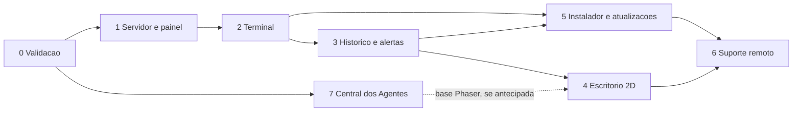

# Terminal Pontual — Roadmap

Status: **revisão 2**. Incorpora a revisão do agente `ecc:architect` e as decisões aprovadas pela Pontual. Nenhuma fase começa sem aprovação.

Não há estimativa de prazo: ela depende das respostas às pendências em [REQUIREMENTS.md](REQUIREMENTS.md) e do resultado da Fase 0. As hipóteses **H-xx** estão em [ARCHITECTURE.md](ARCHITECTURE.md), seção 10.

## Fase 0 — Validação

Objetivo: comprovar ou derrubar as hipóteses antes de escrever o produto. **Nenhum código de produto é escrito nesta fase.** Os testes são feitos em máquina de teste ou máquina virtual com a edição real, nunca em máquina de atendente em uso.

| # | Atividade | Hipóteses | Entrega |
|---|---|---|---|
| 0.1 | Respostas às pendências da Pontual | — | Pendências 1 a 10 respondidas |
| 0.2 | PoC de bloqueio: shell, lista de permissão de execução, políticas | H-01, H-02, H-04 | ADR com a combinação escolhida e a documentação oficial consultada |
| 0.3 | Verificação de que a conta do TI permanece intacta | H-03 | Comparação das duas contas, antes e depois |
| 0.4 | Validação dos privilégios do Service e do Broker | H-05, H-17 | ADR com contas e direitos mínimos |
| 0.5 | Testes de fuga do ambiente controlado | H-07, H-16 | Roteiro executado, com resultado por vetor |
| 0.6 | Testes de recuperação do Windows e de reversão | H-08 | Procedimento de reversão comprovado |
| 0.7 | PoC da ferramenta de suporte remoto | H-06 | ADR com a ferramenta escolhida, ou a conclusão de que nenhuma atende |
| 0.8 | Avaliação de DNS ou proxy para controle real de sites | H-09, H-14 | ADR de infraestrutura |
| 0.9 | Modelo de ameaças, incluindo servidor e administrador comprometidos | — | Documento revisado; decisão sobre a chave do catálogo de executáveis |
| 0.10 | Avaliação construir contra adotar MDM ou RMM | — | ADR |
| 0.11 | Demais verificações | H-10, H-11, H-12, H-13, H-15 | Resultado registrado por hipótese |
| 0.12 | Decisão do modelo de conta da atendente | — | ADR |
| 0.13 | Estrutura do repositório, integração contínua, ambiente de desenvolvimento | — | Repositório compilando, sem código de produto |
| 0.14 | Direção de arte e sprites provisórios | — | Paleta e conjunto mínimo |

**Critérios de saída:**

1. Toda hipótese H-01 a H-17 tem resultado registrado: comprovada, derrubada ou substituída.
2. Existe uma combinação de bloqueio que funciona na edição real **e** deixa a conta do TI intacta. Sem isso, o projeto não avança.
3. A reversão foi executada com sucesso pelo menos duas vezes.
4. O modelo de ameaças foi revisado, e os documentos foram atualizados com o que mudou.
5. Aprovação da Pontual.

Se alguma hipótese cair, a arquitetura é revista antes da Fase 1.

## Fase 1 — Servidor e painel básico

- Modelo de dados e migrações.
- Login com segundo fator, códigos de recuperação e acesso de emergência.
- Matriz de permissões implementada, com testes gerados a partir dela.
- Auditoria encadeada, com âncora externa.
- Unidades, administradores, máquinas (com aprovação) e atendentes.
- Service mínimo: registra-se, autentica-se, envia presença. Ainda sem bloqueio e sem Broker.
- Painel: lista de máquinas com status ao vivo.

**Critérios de saída:** uma máquina real aparece online depois de aprovada; revogar derruba a conexão; cada linha da matriz de permissões tem teste passando; a verificação da cadeia de auditoria detecta uma alteração feita de propósito.

## Fase 2 — Terminal da atendente

- Shell em tela cheia e identificação da atendente.
- Broker, com o conjunto fechado de operações.
- Cadastro de sites e de executáveis, com aprovação por dois administradores.
- Perfis, publicação assinada com sequência global, distribuição e confirmação.
- Lista de bloqueio fixa e navegador embutido endurecido.
- Aplicação do bloqueio validado na Fase 0.
- **Recuperação desde o primeiro dia:** reversão local pelo TI e modo manutenção.
- Funcionamento sem servidor e aviso de monitoramento.

**Critérios de saída:** roteiro de fuga sem falha aberta; reversão testada; conta do TI intacta; terminal recusa configuração com assinatura inválida, sequência antiga ou executável da lista fixa; manutenção expira sem servidor.

## Fase 3 — Histórico, eventos e alertas

- Coleta de uso e eventos, com fila local priorizada.
- Histórico por máquina e por atendente, com leitura individual auditada.
- Regras de alerta configuráveis.
- Registro dos logons locais do TI, se H-12 foi comprovada.
- Exportação para o titular, retenção automática de todas as tabelas.

**Critérios de saída:** painel administrativo completo, sem as cenas 2D; rotina de retenção executada e auditada; exportação de titular validada com o RH.

## Fase 4 — Escritório virtual 2D

- Base Phaser compartilhada (`src/game-shared/`).
- Cena com estações ligadas às máquinas reais e editor de posição.
- Seis estados animados e painel de detalhes.
- Atalho de suporte remoto presente, **desabilitado** até a Fase 6.
- Tempo real, visão em lista, cenário esmaecido sem conexão.

**Critérios de saída:** cada estado da cena é provocado por um estado real no servidor de teste; nenhum dado da cena existe sem origem no servidor.

## Fase 5 — Instalador e atualizações

- Instalador com verificação, conta restrita, registro como pendente e relatório.
- Desinstalação com reversão completa.
- Atualização: manifesto assinado fora do servidor, editor fixado, versão crescente, reverificação, retorno local.
- Canais piloto e estável; rotação de chaves.

**Critérios de saída:** instalação e desinstalação limpas em máquina de teste; o terminal recusa pacote antigo, pacote de outro editor e pacote trocado depois da verificação; implantação por anéis: uma máquina, depois três, depois todas.

## Fase 6 — Suporte remoto

- Procedimento de autorização fechado com RH e jurídico.
- Integração da ferramenta escolhida na Fase 0.
- Solicitação, consentimento, procedimento formal com segundo administrador e aviso prévio.
- Aviso permanente independente do Shell; expiração local; agente parado fora de sessão.
- Importação dos registros da ferramenta; atalho habilitado no escritório virtual.

**Critérios de saída:** nenhuma conexão é possível fora de sessão registrada, comprovado por teste; a sessão expira com o servidor desligado; o aviso permanece com o Shell encerrado.

Se a Fase 0 concluir que nenhuma ferramenta atende, esta fase é replanejada antes de começar.

## Fase 7 — Central dos Agentes de IA

A Central dos Agentes é um módulo independente e parte importante do produto; não é a interface das atendentes. Arquitetura em [ARCHITECTURE.md](ARCHITECTURE.md), seção 13.

- Antes de começar: procurar skills de Phaser e de pixel art instaláveis; se não houver adequadas, criar skills próprias do projeto com as convenções da cena. Hoje nenhuma está instalada.
- Confirmar, com subagentes reais, quais dados os *hooks* fornecem sobre o agente de cada ferramenta (H-13, iniciada na Fase 0).
- Instância isolada, com banco e contas próprios.
- Ingestão de eventos e encaminhador dos *hooks* do Claude Code.
- Cena 2D em Phaser com personagens, estados (trabalho, espera, erro, conclusão), tarefas, arquivos e atividade recente.
- Atualização em tempo real por SignalR.
- Agentes próprios do projeto para Windows e DevOps, se a Pontual quiser esses personagens.

**Critérios de saída:** a cena mostra só eventos recebidos; evento sem agente identificado aparece na sessão; a instância não alcança a rede nem as credenciais de produção.

**Dependência corrigida:** esta fase usa a base Phaser. Ela pode ser antecipada para logo após a Fase 0, por não depender do servidor de produção. Nesse caso, a base Phaser compartilhada nasce aqui, e a Fase 4 a reutiliza.

## Dependências entre fases

## Critérios comuns a todas as fases

1. Requisitos da fase atendidos e demonstrados.
2. Testes automatizados passando, incluindo os de autorização.
3. Revisão de segurança sem pendência crítica.
4. A partir da Fase 2: roteiro de fuga e teste de reversão repetidos.
5. Documentação e ADRs atualizados; nenhuma hipótese tratada como fato sem resultado registrado.
6. Aprovação da Pontual.
